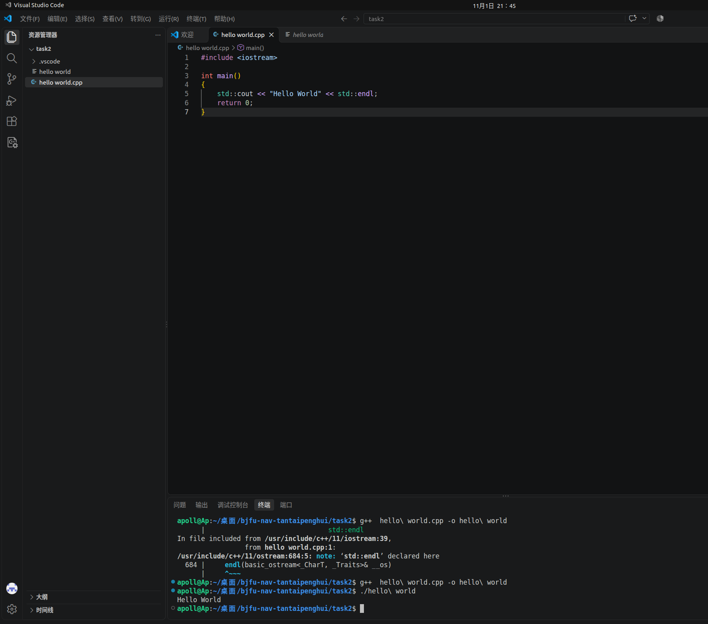
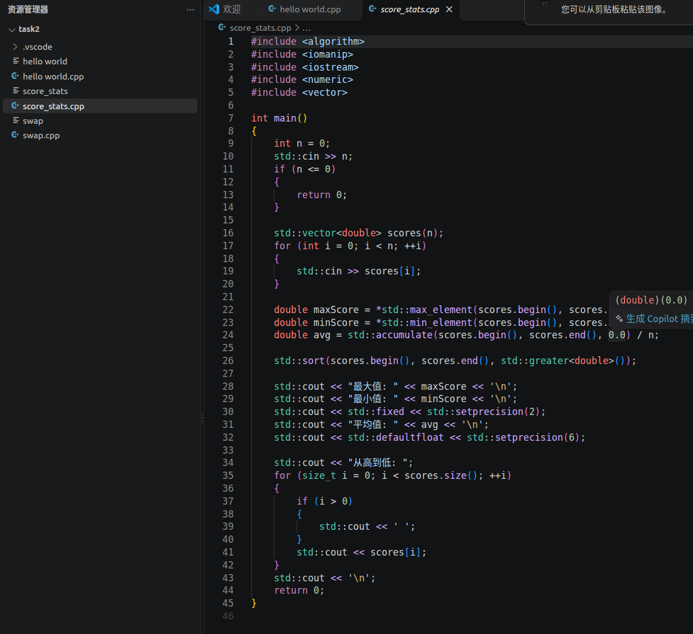
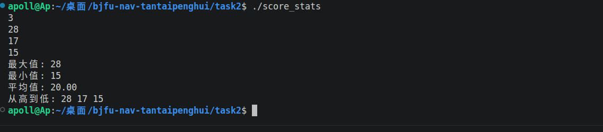
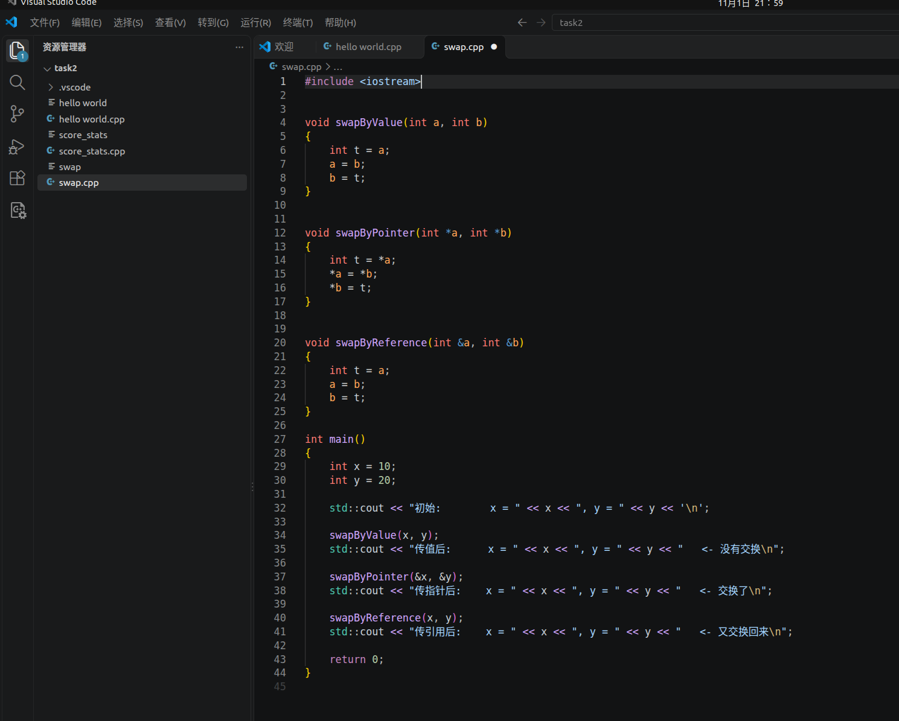
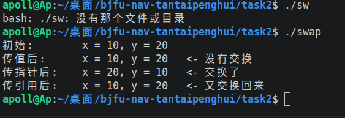

# 任务二：C++ 基础练习

> 环境：Ubuntu 22.04 LTS + g++ 11.4.0
> 每个程序的代码截图与运行结果截图都放在 [`screenshots/`](./screenshots/) 中，并在下面各小节里紧跟对应代码，方便对照查看。

## 目录

| 程序 | 内容 | 代码 | 截图 |
| ---- | ---- | ---- | ---- |
| `hello_world` | 第一个 C++ 程序 | [hello_world.cpp](./hello_world.cpp) | [代码 + 运行](./screenshots/hello_world.png) |
| `score_stats` | 成绩统计：最大值、最小值、平均值、从高到低排序 | [score_stats.cpp](./score_stats.cpp) | [代码](./screenshots/score_stats_code.png) · [运行](./screenshots/score_stats_run.png) |
| `swap` | 传值 / 传指针 / 传引用三种交换方式对比 | [swap.cpp](./swap.cpp) | [代码](./screenshots/swap_code.png) · [运行](./screenshots/swap_run.png) |

## 1. hello_world —— 第一个 C++ 程序

代码：[hello_world.cpp](./hello_world.cpp)

```bash
g++ hello_world.cpp -o hello_world
./hello_world
```



说明：终端里第一次编译报错（编译器提示与 `std::endl` 相关），修正后重新编译通过，运行输出 `Hello World`。

## 2. score_stats —— 成绩统计

代码：[score_stats.cpp](./score_stats.cpp)



运行结果（输入 `3`，再输入 `28 17 15`）：



要点：

- `std::max_element` / `std::min_element` 求最大、最小值；
- `std::accumulate` 求和后除以人数得到平均值，`std::fixed + std::setprecision(2)` 保留两位小数；
- `std::sort(..., std::greater<double>())` 从高到低排序；
- 输出完平均分后用 `std::defaultfloat` 恢复默认精度，避免影响后续输出。

## 3. swap —— 为什么传值交换不了

代码：[swap.cpp](./swap.cpp)



运行结果：



传值的时候函数拿到的只是实参的副本，`swap` 交换的其实就是这两个副本，函数一返回副本就销毁了，原变量从头到尾没被碰过。想让函数真正改到外面，只能把地址（指针）或者变量本身（引用）交进去。

因此运行结果里只有「传值后」没有交换，而「传指针后」和「传引用后」都成功交换了 `x`、`y`。

## 编译运行方式

```bash
cd task2
g++ hello_world.cpp -o hello_world && ./hello_world
g++ score_stats.cpp -o score_stats && ./score_stats
g++ swap.cpp -o swap && ./swap
```
