# 任务二：C++ 基础练习与 VS Code 断点单步调试

> 环境：Ubuntu 22.04 LTS + g++ 11.4.0 + CMake 3.22.1 + VS Code（C/C++ 扩展 / gdb）

本任务包含三个小程序，并用 VS Code 实际打断点、单步调试，截图按「先断点、再命中、后单步」的顺序整理在
[`screenshots/debug/`](./screenshots/debug/) 中。

## 一、任务目标

- 掌握 CMake 多目录工程的组织方式（`include/` + `src/`）；
- 三个程序：`hello_world`（输出）、`score_stats`（成绩统计）、`swap`（三种交换方式对比）；
- 熟悉 VS Code 断点调试：`F9` 打断点、`F5` 启动、`F10` 单步跳过、`F11` 单步进入、`Shift+F5` 结束；
- 保证从零 clone 仓库后，按本文步骤可以一次编译通过并得到预期输出。

## 二、目录结构

```text
task2/
├── CMakeLists.txt          # 构建脚本（默认 Debug，带 -g 调试符号）
├── scores.txt              # score_stats 的输入数据
├── include/
│   ├── score_stats.hpp
│   └── swap.hpp
├── src/
│   ├── hello_world/main.cpp
│   ├── score_stats/main.cpp
│   ├── score_stats.cpp
│   ├── swap/main.cpp
│   └── swap.cpp
├── .vscode/
│   └── launch.json         # 三个程序的 gdb 调试配置
└── screenshots/
    └── debug/              # 断点单步调试截图（01~15，按顺序）
```

## 三、编译与运行（clone 后一次通过）

在干净终端中执行：

```bash
git clone git@github.com:dantaipenghui-hue/bjfu-nav-tantaipenghui.git
cd bjfu-nav-tantaipenghui/task2

# 配置 + 编译（CMake 3.10 及以上）
cmake -S . -B build
cmake --build build
```

编译产物在 `build/` 下，运行并核对输出：

```console
$ ./build/hello_world
Hello World

$ ./build/score_stats scores.txt
最大值: 96
最小值: 78
平均值: 87.80
从高到低: 96 92 88 85 78

$ ./build/swap
初始:        x = 10, y = 20
传值后:      x = 10, y = 20   <- 没有交换
传指针后:    x = 20, y = 10   <- 交换了
传引用后:    x = 10, y = 20   <- 又交换回来
```

> `score_stats` 默认在当前目录读取 `scores.txt`，所以要在 `task2/` 目录里运行；
> 如果在 `build/` 里运行，请写成 `./score_stats ../scores.txt`。

## 四、程序说明

### 1. hello_world —— 第一个 C++ 程序

代码：[`src/hello_world/main.cpp`](./src/hello_world/main.cpp)

```cpp
#include <iostream>

int main()
{
    std::cout << "Hello World" << std::endl;
    return 0;
}
```

### 2. score_stats —— 成绩统计

代码：[`src/score_stats/main.cpp`](./src/score_stats/main.cpp)、[`src/score_stats.cpp`](./src/score_stats.cpp)

- 从 `scores.txt` 读入分数个数与分数；
- `std::max_element` / `std::min_element` 求最大、最小值；
- `std::accumulate` 求和后除以人数得到平均值，`std::fixed + std::setprecision(2)` 保留两位小数；
- `std::sort(..., std::greater<double>())` 从高到低排序。

### 3. swap —— 为什么传值交换不了

代码：[`src/swap/main.cpp`](./src/swap/main.cpp)、[`src/swap.cpp`](./src/swap.cpp)

传值调用时函数拿到的只是实参的副本，交换的是副本，函数返回后副本销毁，原变量没有被修改；
只有传入地址（指针）或引用，才能真正改到 `main` 里的 `x`、`y`。

## 五、VS Code 断点单步调试（截图按顺序）

### 5.1 调试准备

1. 用 VS Code 打开 **`task2` 目录**（注意不是仓库根目录，否则 `launch.json` 里的 `${workspaceFolder}/build/...` 路径对不上）；
2. 安装 C/C++ 扩展（`ms-vscode.cpptools`），确认 `gdb` 可用：`gdb --version`；
3. 先按第三节编译一次，保证 `build/` 下有三个可执行文件；
4. `.vscode/launch.json` 已内置三个配置：`调试 hello_world`、`调试 score_stats`、`调试 swap`；
5. 常用快捷键：`F9` 切换断点，`F5` 启动/继续，`F10` 单步跳过，`F11` 单步进入，`Shift+F5` 结束调试。

### 5.2 hello_world

| 截图 | 说明 |
| ---- | ---- |
| 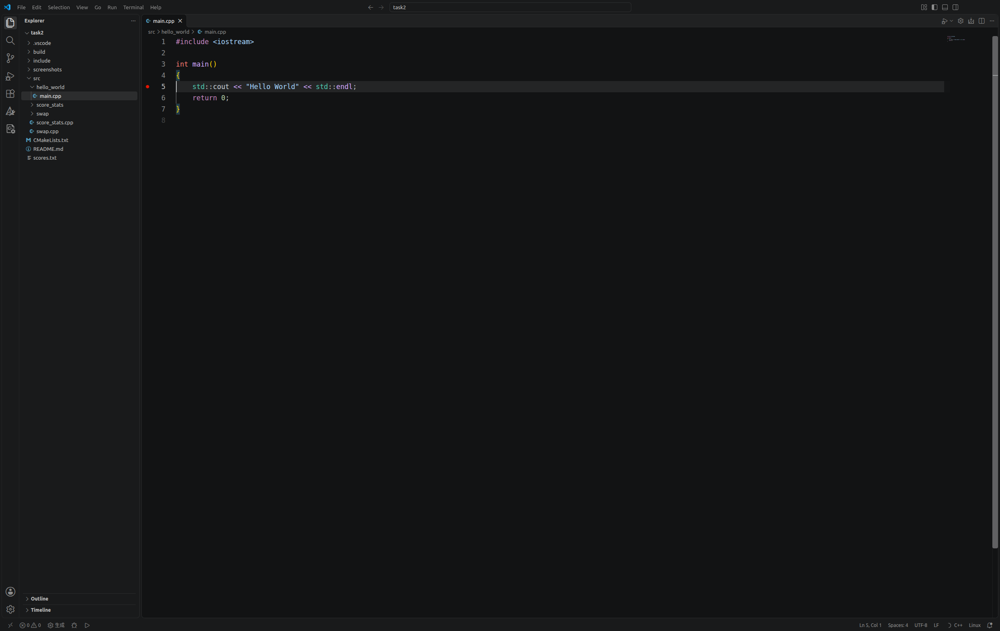 | 在第 5 行 `std::cout` 处按 `F9` 打断点，行号左侧出现红点 |
| 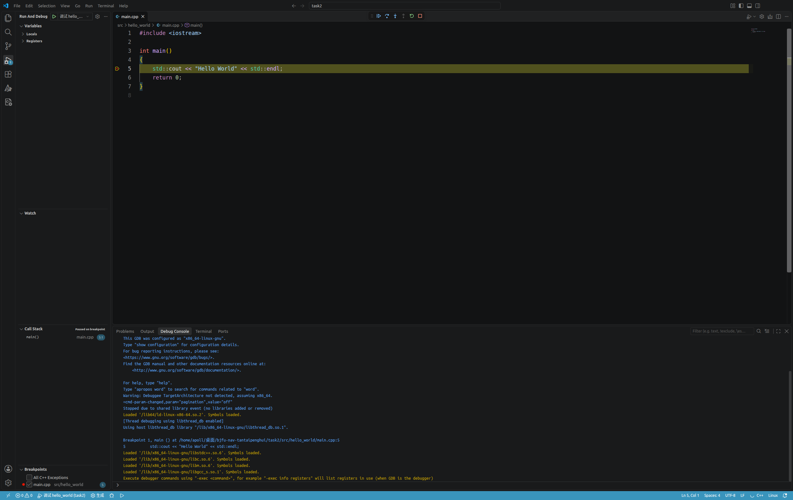 | 按 `F5` 启动后命中断点：当前行黄色高亮，顶部出现调试工具栏，底部是调试控制台 |
| 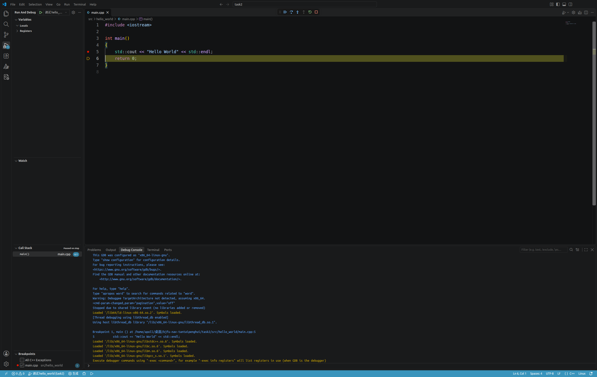 | 按一次 `F10`，执行到第 6 行 `return 0;`，断点仍留在第 5 行 |
| 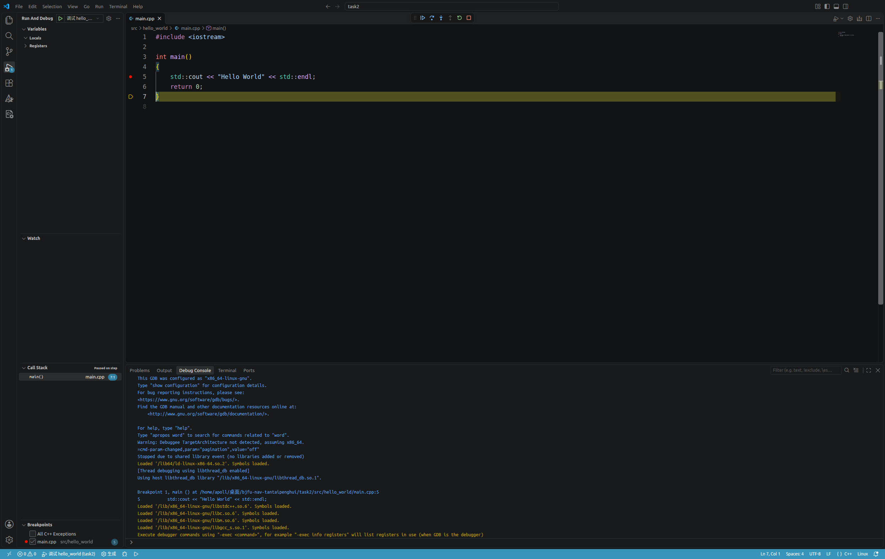 | 再按一次 `F10`，执行到第 7 行（`main` 的右花括号），程序即将结束 |

### 5.3 score_stats

调试配置 `调试 score_stats` 会自动带上参数 `scores.txt`，工作目录是 `task2/`。

| 截图 | 说明 |
| ---- | ---- |
| 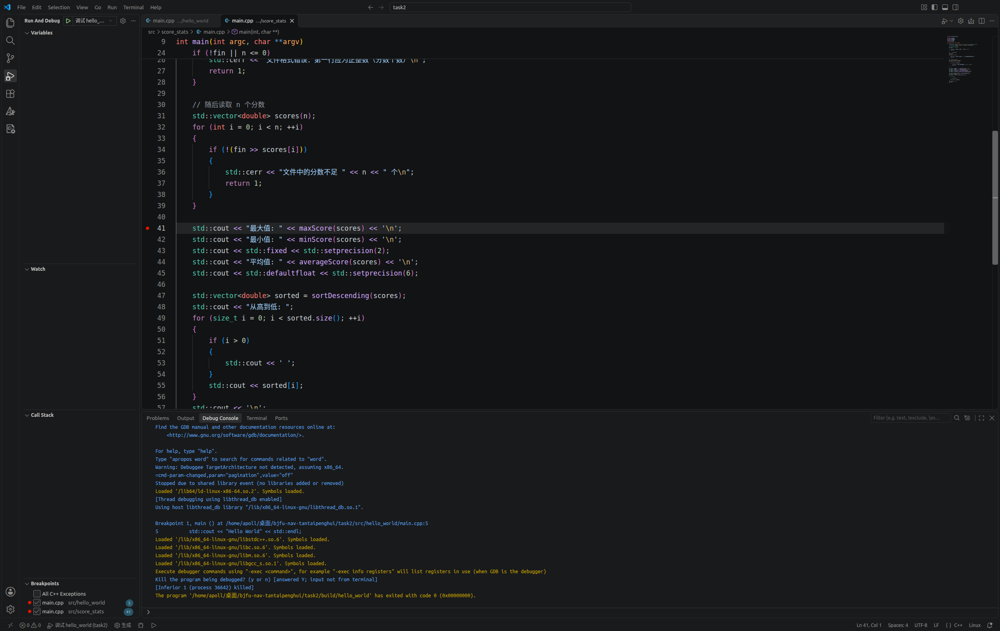 | 在第 41 行（读取完所有分数、准备输出最大值）打断点 |
| 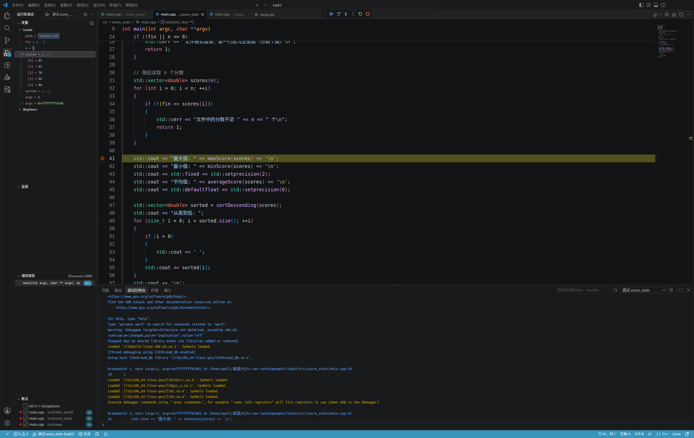 | 命中断点后展开变量 `scores`：`n = 5`，`scores = {85, 92, 78, 96, 88}`，左侧「调用栈」显示 `main` |
| 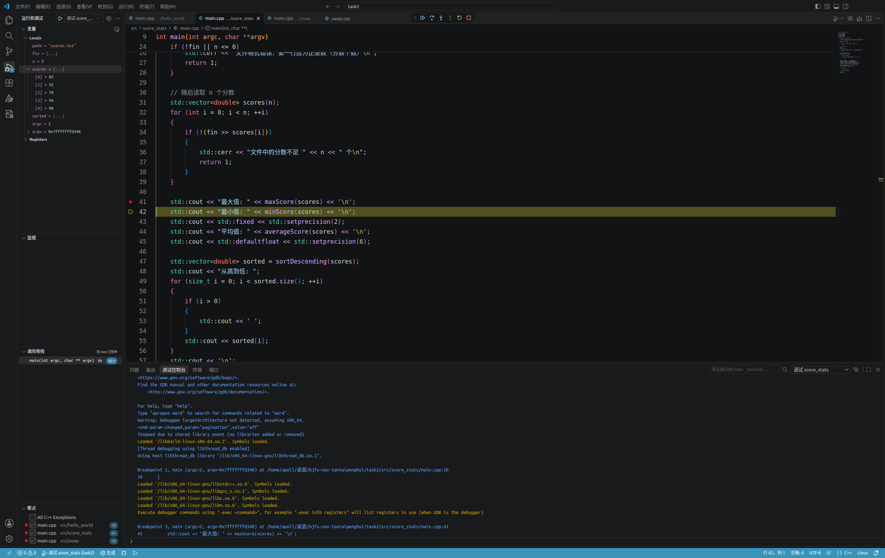 | 按 `F10` 执行「输出最大值」，当前行移到第 42 行，变量值保持不变 |

### 5.4 swap

| 截图 | 说明 |
| ---- | ---- |
| 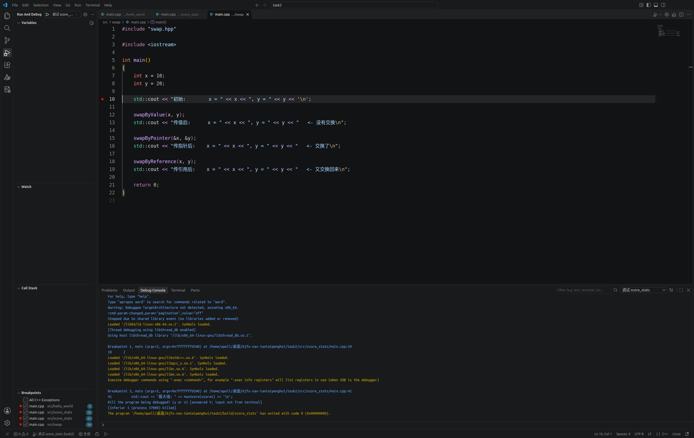 | 在 `main` 第 10 行（第一次输出之前）打断点 |
| 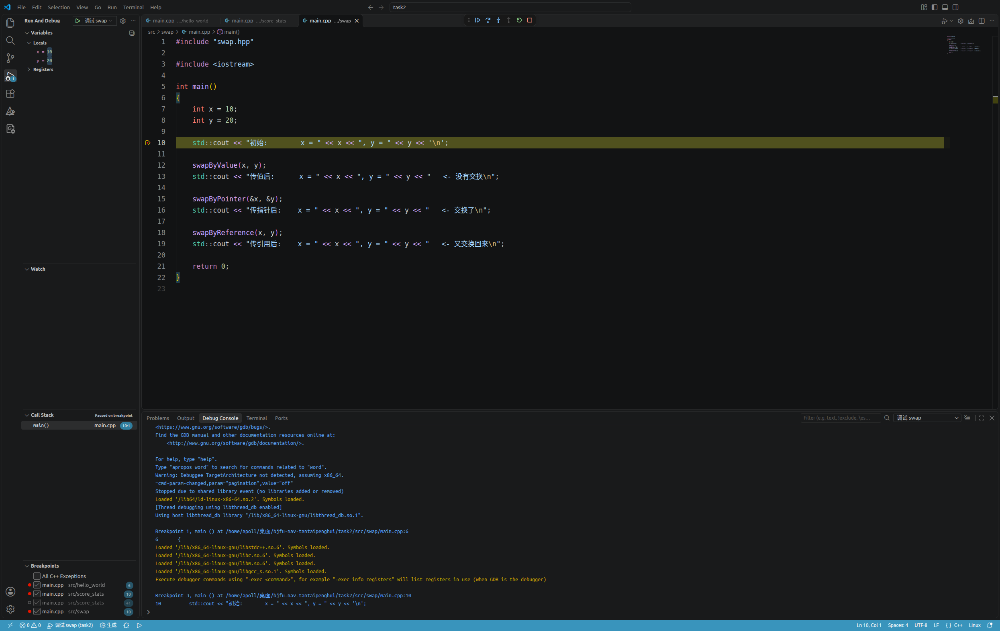 | 命中断点：`x = 10`、`y = 20` |
| 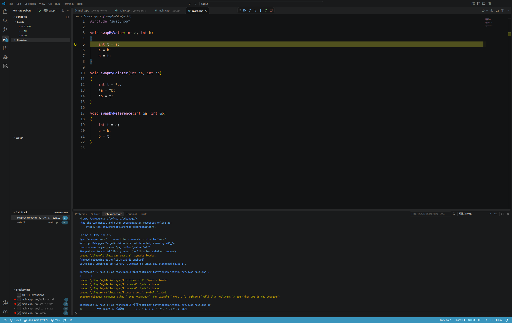 | 单步到第 12 行 `swapByValue(x, y)` 后按 `F11` 单步进入，停在第 5 行 `int t = a;`，调用栈出现两帧 |
| 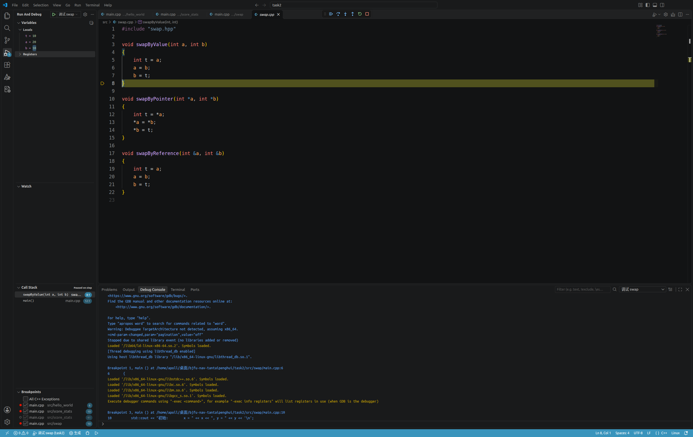 | 连续 `F10` 走完函数体：形参 `a = 20`、`b = 10`、`t = 10`，说明**副本确实被交换了** |
| 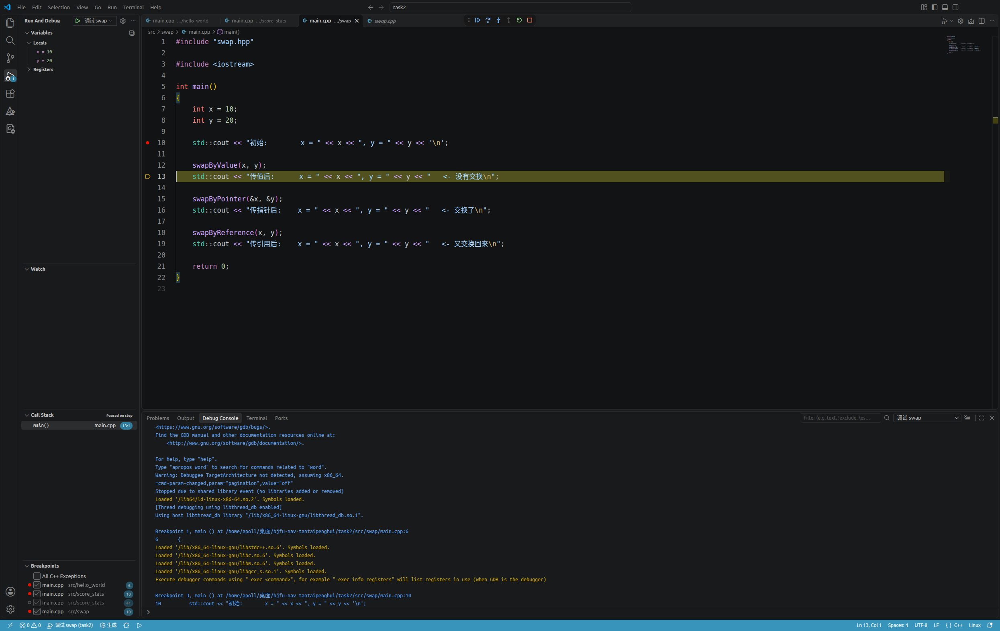 | 返回 `main` 第 13 行：`x = 10`、`y = 20` 原封不动，验证「传值交换失败」 |
| 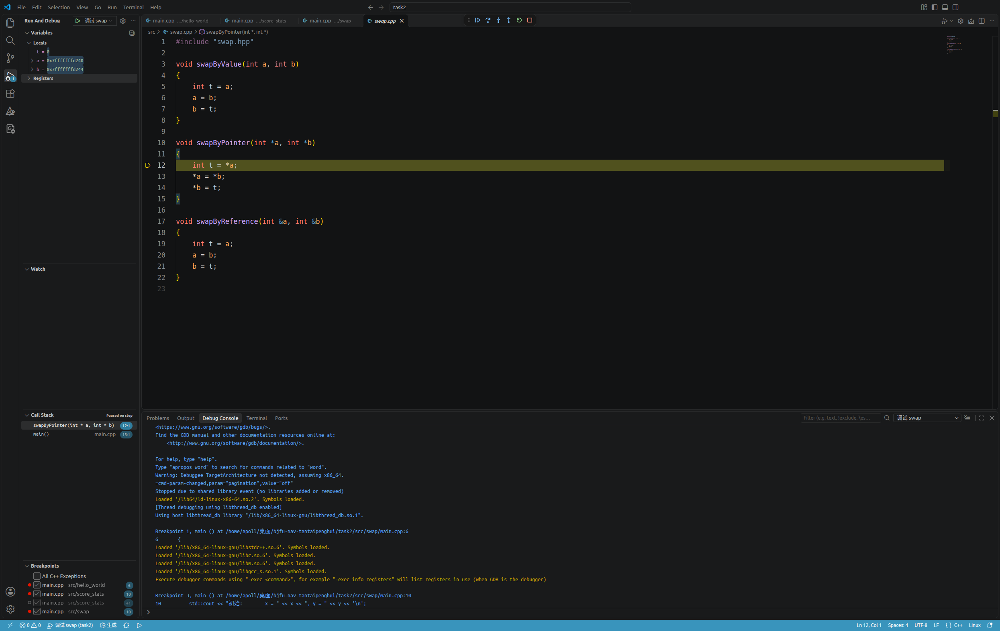 | 单步到第 15 行后按 `F11` 进入 `swapByPointer`，停在第 12 行，形参是指针 `a`、`b` |
| 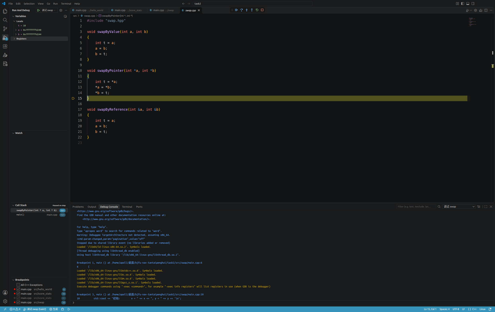 | 继续 `F10` 走完函数体：`a`、`b` 指向 `main` 中 `x`、`y` 的地址，`t = 10` |
| 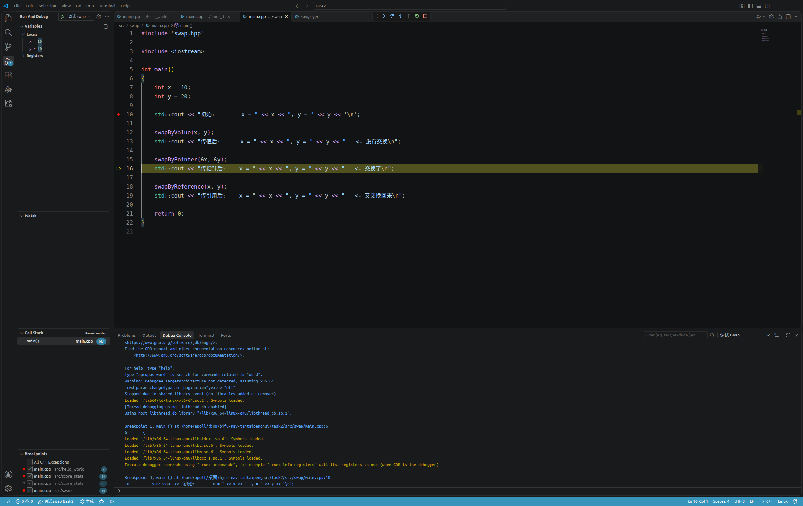 | 返回 `main` 第 16 行：`x = 20`、`y = 10`，指针方式交换成功 |

> 说明：`F10` 是单步跳过（不进入函数），`F11` 是单步进入（进入被调函数），
> 通过对比第 11/12 张（函数内已交换、函数外没变）和第 14/15 张（函数外也变了），可以直观看到传值与传地址的区别。

## 六、常见问题

| 现象 | 原因与解决 |
| ---- | ---------- |
| 按 `F5` 提示找不到程序 | 还没编译，先执行第三节的 `cmake --build build` |
| 断点是灰色空心圆 | 程序与源码不匹配：重新 `cmake --build build` 编译 |
| `score_stats` 报「无法打开文件: scores.txt」 | 运行目录不对，在 `task2/` 下运行，或传 `../scores.txt` |
| 断点不生效 | 确认 VS Code 打开的是 `task2` 目录，且 `launch.json` 里的路径正确 |
