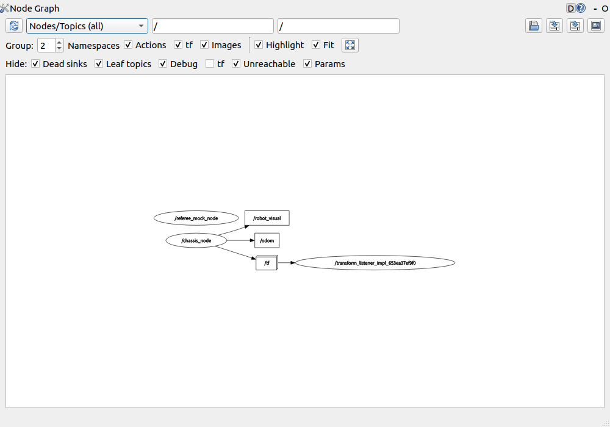
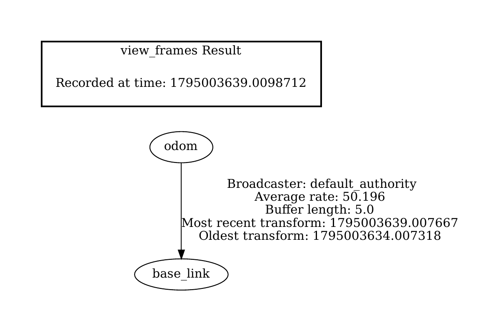
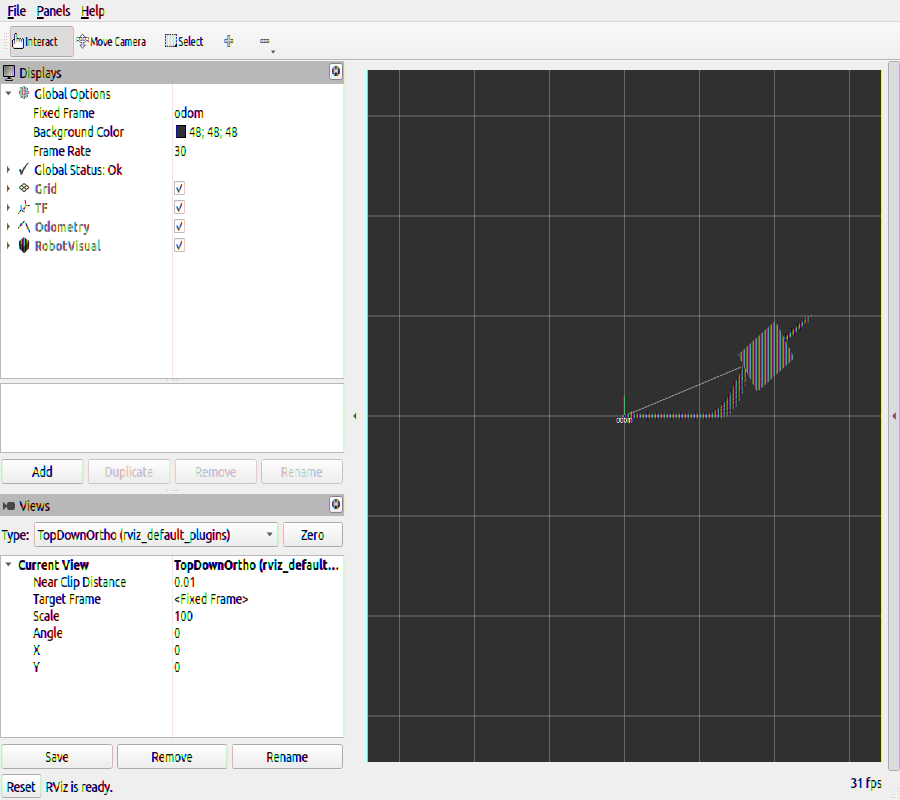

# 任务三：Hello OOP & ROS 2 —— 我的实现与验收记录

> 我的环境：Ubuntu 22.04 LTS + ROS 2 Humble + colcon

这个任务我按“先装环境、再写节点、最后跑通验收”的顺序完成：用面向对象的方式写了三个
ROS 2 节点（底盘、裁判模拟、键盘遥控），串起话题、服务与 TF2，并用 launch 一键启动
两节点和 RViz2，最后录制了键盘驱动 base_link 移动的演示。

## 一、我完成的内容

| 任务要求 | 我的实现 |
| ---- | ---- |
| 安装 ROS 2 Humble，创建 colcon 工作空间与功能包 | 我建了 `task3/ros2_ws/src/rm_oop_demo`，`colcon build` 一次通过、0 警告 |
| 底盘节点 `ChassisNode`：订阅 `/cmd_vel`，积分位姿，发布 `/odom` 与 `odom -> base_link` TF | 我写在 `src/chassis_node.cpp`，50 Hz 发布，TF 广播实测约 50.2 Hz |
| 裁判节点 `RefereeMockNode`：按协议发布阶段、血量、弹量，提供 `/supplyhp` 回血服务 | 我写在 `src/referee_mock_node.cpp`，并定义了 `msg` / `srv` 接口 |
| Launch 一键拉起两节点与 rviz2，用键盘节点驱动 base_link | 我写了 `launch/bringup.launch.py`、`src/keyboard_teleop_node.cpp` 和 `rviz/odom_demo.rviz` |

## 二、目录结构

```text
task3/
├── README.md                     # 本文件：我的实现与验收记录
├── ros2_ws/
│   └── src/
│       └── rm_oop_demo/
│           ├── CMakeLists.txt    # ament_cmake 构建 + rosidl 接口生成
│           ├── package.xml
│           ├── include/rm_oop_demo/
│           │   ├── chassis_node.hpp
│           │   ├── referee_mock_node.hpp
│           │   └── keyboard_teleop_node.hpp
│           ├── src/
│           │   ├── chassis_node.cpp
│           │   ├── referee_mock_node.cpp
│           │   └── keyboard_teleop_node.cpp
│           ├── msg/
│           │   ├── GameStatus.msg
│           │   ├── RobotStatus.msg
│           │   └── AmmoStatus.msg
│           ├── srv/
│           │   └── SupplyHp.srv
│           ├── launch/
│           │   └── bringup.launch.py
│           └── rviz/
│               └── odom_demo.rviz
└── screenshots/
    ├── rqt_graph.png             # 我运行时的节点/话题计算图
    ├── tf_tree.png               # 我用 view_frames 导出的 TF 树
    ├── rviz_odom.png             # 键盘驱动后的 RViz2 画面
    └── demo.mp4                  # 键盘驱动 base_link 移动的录屏
```

## 三、我是怎么安装 ROS 2 Humble 的

一开始我用官方脚本里的 `raw.githubusercontent.com` 下载 key，但连接超时，于是换成清华镜像源：

```bash
sudo apt install -y curl gnupg
sudo install -d -m 0755 /usr/share/keyrings
curl -fsSL https://mirrors.tuna.tsinghua.edu.cn/rosdistro/ros.key \
  -o /tmp/ros.key
sudo mv /tmp/ros.key /usr/share/keyrings/ros-archive-keyring.gpg

echo "deb [arch=amd64 signed-by=/usr/share/keyrings/ros-archive-keyring.gpg] https://mirrors.tuna.tsinghua.edu.cn/ros2/ubuntu jammy main" \
  | sudo tee /etc/apt/sources.list.d/ros2.list

sudo apt update
sudo apt install -y \
  ros-humble-desktop \
  ros-humble-tf2-tools \
  ros-humble-rqt-tf-tree \
  python3-colcon-common-extensions \
  graphviz

echo "source /opt/ros/humble/setup.bash" >> ~/.bashrc
```

## 四、我是怎么编译的

```bash
cd task3/ros2_ws
colcon build --symlink-install
source install/setup.bash
```

我实际跑出来的结果：

```text
Starting >>> rm_oop_demo
Finished <<< rm_oop_demo [4.55s]

Summary: 1 package finished [4.61s]
```

我在 `CMakeLists.txt` 里加了 `-Wall -Wextra -Wpedantic`，构建日志里 **0 条 warning**。

> 这里我踩了一个坑：因为包里有自定义 msg/srv，rosidl 生成依赖的 CMake `file(STRINGS)`
> 只支持 ASCII，工作空间放在含中文的路径（比如“桌面”）会直接报错。
> 所以我把仓库移到了 `~/projects/bjfu-nav-tantaipenghui`，桌面留了同名软链接。

## 五、我是怎么运行和验收的

```bash
source /opt/ros/humble/setup.bash
cd ~/projects/bjfu-nav-tantaipenghui/task3/ros2_ws
source install/setup.bash

# 一键启动：ChassisNode + RefereeMockNode + 键盘节点 + RViz2
ros2 launch rm_oop_demo bringup.launch.py
```

验收时我更喜欢把键盘节点单独放在一个终端，按键输入更干净：

```bash
# 终端 1
ros2 launch rm_oop_demo bringup.launch.py use_keyboard:=false

# 终端 2
ros2 run rm_oop_demo keyboard_teleop_node
```

我自己用的按键：

| 按键 | 功能 |
| ---- | ---- |
| `w` / `s` | 前进 / 后退（默认 0.5 m/s） |
| `a` / `d` | 左转 / 右转（默认 1.0 rad/s） |
| `x` 或空格 | 停止 |
| `q` | 退出键盘节点 |

需要调参时我直接用 ROS 参数覆盖，例如：

```bash
ros2 run rm_oop_demo keyboard_teleop_node --ros-args -p linear_speed:=0.8
ros2 run rm_oop_demo chassis_node --ros-args -p publish_rate:=100.0
```

## 六、我的节点与接口设计

### 1. 话题与服务

| 名称 | 类型 | 方向 | 说明 |
| ---- | ---- | ---- | ---- |
| `/cmd_vel` | `geometry_msgs/msg/Twist` | 键盘节点 → 底盘节点 | 速度指令 |
| `/odom` | `nav_msgs/msg/Odometry` | 底盘节点发布 | 积分得到的位姿与当前速度 |
| `/robot_visual` | `visualization_msgs/msg/Marker` | 底盘节点发布 | RViz2 中看到的机器人方块 |
| `/tf` | `tf2_msgs/msg/TFMessage` | 底盘节点广播 | `odom -> base_link` 变换 |
| `/referee/game_status` | `rm_oop_demo/msg/GameStatus` | 裁判节点发布 | 比赛阶段与阶段剩余时间 |
| `/referee/robot_status` | `rm_oop_demo/msg/RobotStatus` | 裁判节点发布 | 当前血量 / 最大血量 |
| `/referee/ammo_status` | `rm_oop_demo/msg/AmmoStatus` | 裁判节点发布 | 17mm 弹丸剩余发弹量 |
| `/supplyhp` | `rm_oop_demo/srv/SupplyHp` | 服务 | 请求回血，返回是否成功与当前血量 |

我按 RM 裁判系统常用字段做了简化版协议：

```text
GameStatus:  game_progress / stage_remain_time / current_round / total_rounds
RobotStatus: robot_id / current_hp / max_hp
AmmoStatus:  robot_id / remaining_ammo
SupplyHp:    request.amount -> response.success / response.current_hp / message
```

裁判节点我默认按 1 Hz 发布：血量每秒衰减 1 点、弹量每 2 秒消耗 1 发，
阶段剩余时间归零后把 `game_progress` 置为 5（结算）。

### 2. 面向对象与智能指针

- 三个节点类都继承 `rclcpp::Node`，参数、发布器/订阅器、服务、定时器都在构造函数里创建；
- 节点对象在 `main()` 里用 `std::make_shared` 创建后交给 `rclcpp::spin`；
- TF 广播器我用 `std::unique_ptr<tf2_ros::TransformBroadcaster>` 独占管理；
- 底盘位姿（`x_ / y_ / yaw_`）和裁判状态（血量/弹量/阶段）都封装在类内，由私有方法更新。

### 3. 底盘位姿积分

我用的离散积分模型：

```text
x_{k+1}   = x_k + (v_x cosθ - v_y sinθ) Δt
y_{k+1}   = y_k + (v_x sinθ + v_y cosθ) Δt
θ_{k+1}   = θ_k + ω_z Δt
```

每次定时器回调（默认 50 Hz）先积分位姿，再同步发布 `/odom`、`odom -> base_link`
TF 和 `/robot_visual` 方块。

## 七、我实际跑出来的验收结果

### 1. 底盘与 TF

```console
$ ros2 topic echo /odom --once
header:
  stamp: {sec: 1795003074, nanosec: 392489719}
  frame_id: odom
child_frame_id: base_link
pose:
  pose:
    position: {x: 1.1741913862866122, y: 1.692151424372004, z: 0.0}
    orientation: {x: 0.0, y: 0.0, z: 0.823852463731638, w: 0.5668043030917373}
```

```console
$ ros2 run tf2_ros tf2_echo odom base_link
At time 1795003075.572577121
- Translation: [0.845, 2.175, 0.000]
- Rotation: in RPY (radian) [0.000, -0.000, 2.408]
```

`view_frames` 统计的 TF 发布频率是 **50.196 Hz**，缓冲长度 5 s。

### 2. 裁判节点与回血服务

```console
$ ros2 topic echo /referee/robot_status --once
header: {stamp: {sec: 1795003055, nanosec: 93879541}, frame_id: referee}
robot_id: 1
current_hp: 166
max_hp: 200

$ ros2 service call /supplyhp rm_oop_demo/srv/SupplyHp "{amount: 50}"
response:
rm_oop_demo.srv.SupplyHp_Response(success=True, current_hp=200, message='回血成功')
```

回血后下一帧 `/referee/robot_status` 的 `current_hp` 立即变成 200（满血封顶）。

### 3. 键盘节点

```console
$ ros2 topic echo /cmd_vel --once     # 按下 w 后
linear:  {x: 0.5, y: 0.0, z: 0.0}
angular: {x: 0.0, y: 0.0, z: 0.0}

$ ros2 topic echo /cmd_vel --once     # 再按下 a 后
linear:  {x: 0.5, y: 0.0, z: 0.0}
angular: {x: 0.0, y: 0.0, z: 1.0}

$ ros2 topic echo /cmd_vel --once     # 按下 x 后
linear:  {x: 0.0, y: 0.0, z: 0.0}
angular: {x: 0.0, y: 0.0, z: 0.0}
```

### 4. rqt_graph



从图里可以看到 `/chassis_node` 发布 `/odom`、`/tf`、`/robot_visual`，
其中 `/odom` 和 `/robot_visual` 被 `/rviz2` 订阅；`/transform_listener_impl_*`
是 RViz2 的 TF 监听器。

### 5. TF 树



树结构是 `odom -> base_link`，默认广播器以约 50 Hz 发布。

### 6. RViz2 与录屏

键盘驱动后的画面（绿块是 `base_link` 上的机器人模型，青色箭头是里程计轨迹）：



录屏：[demo.mp4](./screenshots/demo.mp4)（8 秒：`w` 前进 → `a` 转向 → `w` 前进 → `s` 后退 → `x` 停止）。

## 八、我踩过的坑和处理办法

1. **`raw.githubusercontent.com` 超时**：换成清华 ROS 镜像源和 `rosdistro` 镜像 key，安装就顺利了。
2. **中文路径导致 rosidl 失败**：CMake `file(STRINGS)` 只支持 ASCII，含“桌面”等中文的构建路径会报
   `list index: 1 out of range`；我把仓库移到 `~/projects/bjfu-nav-tantaipenghui` 后标准
   `colcon build` 就通过了。
3. **Wayland 下截屏/录屏受限**：GNOME Shell 的截图接口被拒绝，我改用 `xwd` 抓取 XWayland
   窗口、再逐帧编码成 MP4，完成了 RViz2 截图和演示录屏。
4. **键盘节点读键阻塞**：终端用 raw 模式读按键，同时对非 TTY 输入设置 `O_NONBLOCK`，
   避免单线程执行器被 `read()` 卡住；节点析构时恢复终端属性。
